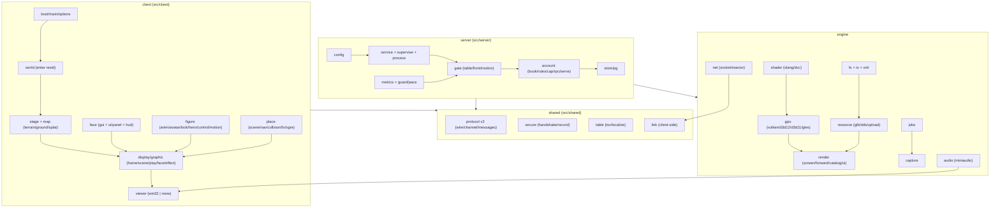

# ARCHITECTURE_AS_IS — tái dựng từ implementation

Scope: kiến trúc hiện tại đã chứng minh từ source (AS-IS). Không trình bày
TO-BE ở đây (khuyến nghị nằm trong `FINDINGS.md` từng mục). Mermaid chỉ vẽ
ranh giới đã xác minh bằng `game_reject_foreign` + `GameLayers.cmake`.

## Khởi động và executable

Client: `src/client/app/client/main.cpp` → `boot` (nạp `erengu_DL`) →
`Display::create/show/play` (vòng spin ở `src/client/app/client/display/graphic/frame.cpp`,
`state.hpp`) → `Viewer` (Win32/SDL3) hoặc `viewer_none` (không cửa sổ).
Server: 7 exe đều là main mỏng gọi `service::run(Kind)`; `supervisor` spawn
  `store→auth→billing→world→zone→gate` theo `dev/server/config/supervisor.toml`, đọc dòng
`ready` trên stdout con, dừng ngược thứ tự. Gate là exe duy nhất mở cổng công
khai (`0.0.0.0:7000/7001`); `admin` nghe loopback `:7002`; ipc nội bộ loopback.

## Phụ thuộc module (SOURCE-CONFIRMED)

- Engine chỉ thấy `engine/`. Shared thấy thêm `src/shared`. Client thấy
  `engine + shared + src/client`. Server thấy `engine + shared + src/server`.
  Configure dừng khi vi phạm (`game_reject_foreign`, `CMakeLists.txt:112-138`).
- Bảng tầng `cmake/GameLayers.cmake` là nguồn sự thật (73 dòng `game_layer_*`).
- `Display` mượn `Stage/Ground` không sở hữu (`src/client/app/client/display/display.hpp:81-85`); luồng vẽ nạp
  ở khung kế — host hủy sớm là UAF (đã ghi trong comment).

## Data flow chính

- Asset: `_raw` → (`export_glb`) → `_glb` → (`collect_map/collect_fx/collect_ui/
  collect_avatar/export_config/export_look`) → `dev/client/assets` →
  (`build_i18n` theo `GAME_LANGUAGE=zh`) → client runtime. Shader:
  `*.slang` → `thienlong_shader` → `*.f2s` → `client/bin/shaders` (mobile copy
  từ cây PC). Âm thanh: `sound/` → `thienlong_audio cook` → `build/cooked/sound`.
- Khung hình: `World.enter` → `Stage/Ground + walk + buildings` → `Display`
  (`preload` luồng nền + `kick_loading`) → `Forward` (3D) + `Hud.prepare/draw`
  (2D) + `fx` (`advance_fx`) → `submit_frame/present`.
- Mạng: `TCP accept → ServerHandshake → Hello → Welcome(v2) → Login/Resume →
  SessionStart(token 16B single-use) → UiConfig (nếu client_version≥2) →
  CharacterList/Position → Move (qua `guard::Pace`) → idle/timeout drop`.
  Restart gate mất phiên (`src/server/gate/table.cpp:169`).

## Threading và ownership

- `jobs`: thợ Chase-Lev + hàng chung, `wait` chạy giúp, trạng thái luồng
  `thread_local`. `net`: một luồng `wait/watch/submit`, chỉ `wake()` chéo luồng;
  `SpscMail` 1-đẩy/1-lấy. `fs::File`: chỉ `read_at` đa luồng; còn lại không khoá.
- `gpu`: handle index+generation, `Slots` lock-free, `Retired` thu hồi theo khung,
  sync chỉ qua `Timeline`; semaphore WSI giấu sau Swapchain. Slot = index ảnh
  swapchain vừa acquire — sai slot là ghi đè buffer đang đọc (không guard runtime).
- `supervise`: thuần trạng thái, không luồng/không I/O, bên gọi bơm `advance(now)`.
- `process::Child` sở hữu pipe/handle; huỷ gọi `force_stop` chờ `INFINITE`.

## Error handling path

- Lỗi lập trình → `core::check/fail` (abort, luôn bật cả release).
- Lỗi vận hành → `std::expected` + `enum class` (`core::Result/Status`,
  `NetError` 10 mã, `XmlError`, `LoadError` 22 nhánh của collision, `ReadyFault`).
- Ngoại lệ: cấm trong game/net; `jobs` mang lỗi job bằng `exception_ptr` +
  rethrow (lệch quy tắc core, đã ghi finding).
- Dữ liệu client → kiểm biên/trần trước cấp phát, trả lỗi/bỏ gói/đếm; wire strict,
  channel có trần, frame client 4096B, rate 60/s + per-IP + CIDR deny-trước.

## Ranh giới tái sử dụng

`engine/` độc lập thật (không include game). `src/shared` (protocol/secure/table)
dùng được cho cả hai phía. `src/client/figure|place` phụ thuộc asset client 2026
nên khó tách. `src/server/supervise` + `content` thuần logic, dễ tái dùng nhất.
